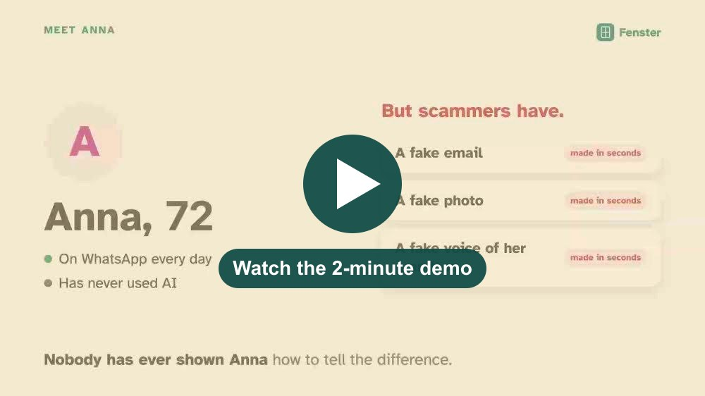
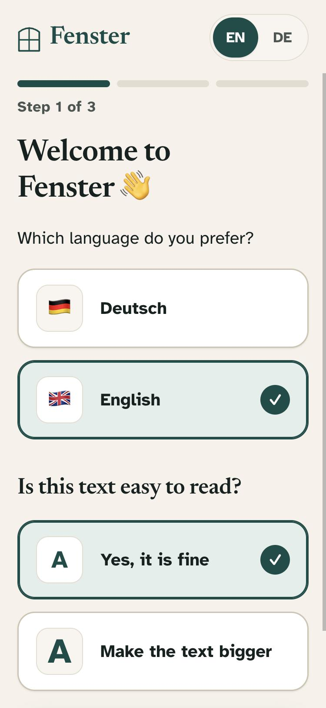
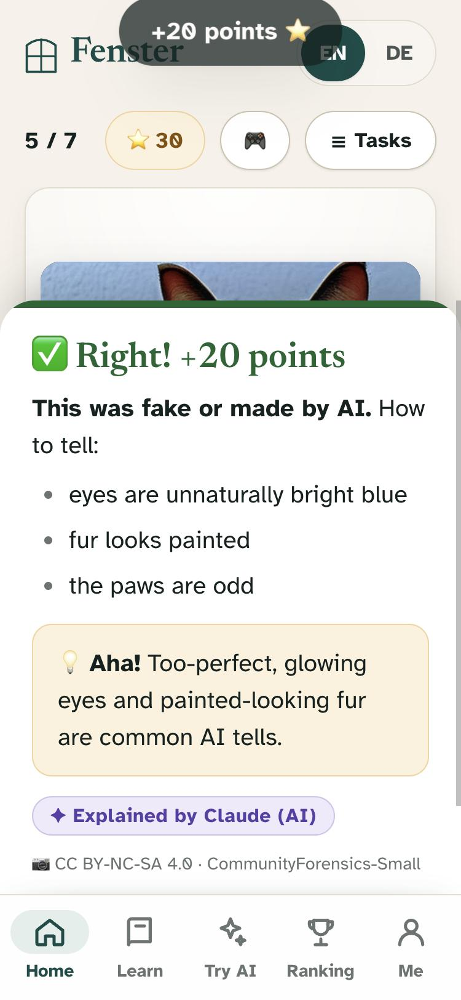
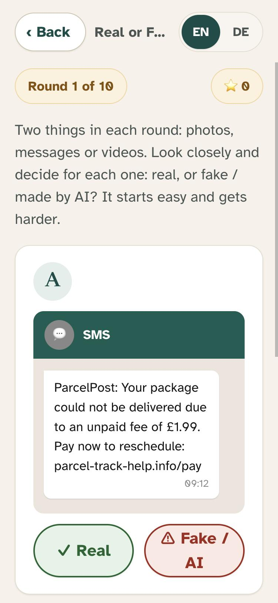
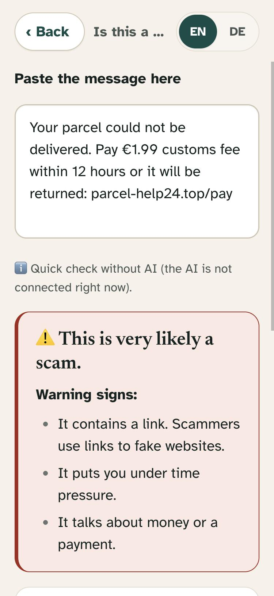

# Real or Fake?

> ### 👉 Try it now: **[rs.neurorelations.tech:8444/fenster](https://rs.neurorelations.tech:8444/fenster/)**
> It works on any phone or laptop, no app and no sign-up. Jump straight into the game: **[Real or Fake? game](https://rs.neurorelations.tech:8444/fenster/app/#/play)**

<a href="https://drive.google.com/file/d/12CT2IY9n2VcVjZpE_yhppCOpvJvVRzJs/view"></a>

**One line:** A TikTok-style swipe game that helps older adults on WhatsApp spot AI fakes and scam messages and try using AI themselves.

## The problem
Older adults use WhatsApp every day, and that is where AI fake videos, voice clones and scams get forwarded to them. Most of them have never used AI, so they can't tell what is real and don't know AI can also help them. Warnings don't build that skill; safe practice with patient explanations does.

## What it does
- Opens from a link in WhatsApp, no app or account needed.
- **"Real or Fake?" game:** photos, messages and videos. Guess if each one is real or made by AI, easy first, harder later.
- After each answer you see **what gave it away** and a short, friendly explanation.
- **Scam checker:** paste a suspicious message and Claude explains if it's a scam and why.
- Big text, English and German, and a daily challenge to play with family.

## How Claude is used
- **Explains:** Claude (`claude-opus-5-5`) wrote the clues and plain-language explanations for every photo and message.
- **Writes practice content:** AI-written texts, modern scams and legit messages for the game.
- **Checks scams live:** in the app, Claude reads a pasted message and explains the warning signs.

## How to run it
```bash
npm install
cp .env.example .env    # optional: paste your ANTHROPIC_API_KEY
npm start               # then open http://localhost:3000
```
Needs Node.js 20.6+. More for developers: [AGENTS.md](AGENTS.md) and [dataset/README.md](dataset/README.md).

**Live link (if any):** https://rs.neurorelations.tech:8444/fenster/

## Screenshots / demo
🎬 **Demo video (2 min):** [watch on Google Drive](https://drive.google.com/file/d/12CT2IY9n2VcVjZpE_yhppCOpvJvVRzJs/view)

| Onboarding | Feed: answer explained | "Real or Fake?" game | Scam checker |
|---|---|---|---|
|  |  |  |  |

## Team
Teams of 5 (at least 1 builder, 1 product or design, 1 domain expert; plus founder or anyone). Link each name to a GitHub or LinkedIn profile, and replace the example row with your team.

| Name | Role / background |
|---|---|
| [Oscar J. Hernandez](https://github.com/OscarJHernandez) | Data science, Engineering |
| [Natalia Sahagun](https://github.com/nalius-sp) | Product / Design, Consultancy and Project Management |
| [Ruthvick Poornachandra](https://github.com/ruthvick7) | Domain expert (product) |
| Mariia Liashchenko | Product designer |
| [Mikhail Popov](https://github.com/mikhailpopov6) | Builder, DevRel |

## Credits
<Open-source libraries, APIs, datasets and assets you used.>

**Dataset** (details in [dataset/README.md](dataset/README.md)):
- Fake images: [CommunityForensics-Small](https://huggingface.co/datasets/OwensLab/CommunityForensics-Small) and [CommunityForensics-Eval](https://huggingface.co/datasets/OwensLab/CommunityForensics-Eval) (CC BY-NC-SA 4.0, non-commercial educational use)
- Real photos: [Wikimedia Commons](https://commons.wikimedia.org), license and author per image in `dataset/items.json`
- Videos ([content/videos/](content/videos/README.md)): real and AI clips made and shared by the team on [Canva](https://www.canva.com), and the AI singer "Nyla Stone" by [@nyla.stonesb](https://www.tiktok.com/@nyla.stonesb) on TikTok, shown with TikTok's official embedded player (not copied)
- Real SMS and spam: [UCI SMS Spam Collection](https://archive.ics.uci.edu/dataset/228/), Almeida & Hidalgo (2011), CC BY 4.0
- Font: [Atkinson Hyperlegible](https://www.brailleinstitute.org/freefont/) by the Braille Institute (SIL Open Font License), via Google Fonts
- Libraries: [@anthropic-ai/sdk](https://github.com/anthropics/anthropic-sdk-typescript), [sharp](https://sharp.pixelplumbing.com), [hyparquet](https://github.com/hyparam/hyparquet), ESLint, Prettier
