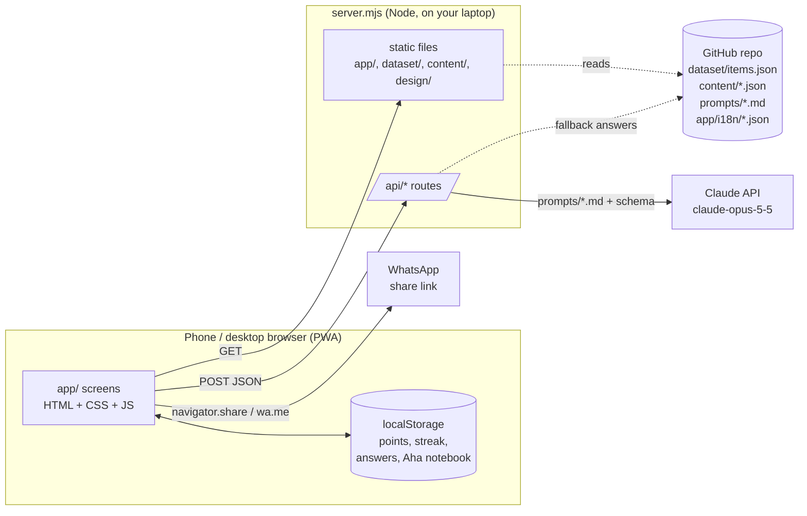
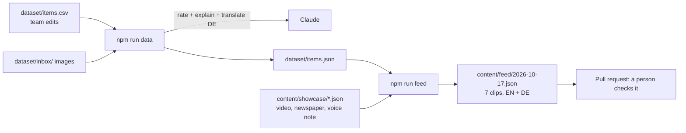

# Fenster architecture

> Status: v1 plan for the demo build (17 Oct 2026). Read with [BEST_PRACTICES.md](BEST_PRACTICES.md) and
> [DESIGN_PHILOSOPHY.md](DESIGN_PHILOSOPHY.md). Update this file when a decision changes.

## Goal and constraints

- **An interactive prototype we run locally and screen-record** for the 2-minute demo.
- **No auth, no database.** Everything lives in GitHub: content, dataset, prompts, translations. A database can be
  added later behind one module (see "Later").
- **Claude is part of the product**, not only the tool that built it.
- **English + German** from the start.
- Matches what is already on `main`: plain Node project, ES modules, `@anthropic-ai/sdk`, ESLint + Prettier +
  `node --test`, CI on every PR.

## The stack

| Layer | Choice | Why |
|---|---|---|
| App (frontend) | **Plain HTML + CSS + JavaScript (ES modules)**, no framework, no build step | Same as `prototype/` and `dataset/loader.js`. Anyone on the team can read it, nothing to compile, fastest to change on demo day |
| Installable app | **PWA**: `manifest.webmanifest` + a small service worker that caches the app shell | Opens like an app on phone and desktop, no app store |
| Server | **One Node 20+ file, `server.mjs`**, built on `node:http` (no Express) | Serves the app and a few `/api/*` routes. Keeps the API key off the phone |
| AI | **Claude via `@anthropic-ai/sdk`** (already installed), model `claude-opus-5-5` like `scripts/lib/claude.mjs` | One model everywhere. Live routes use `effort: "low"` to stay fast; JSON answers use a JSON schema (`output_config.format`) |
| Content & data | **JSON/CSV files in git**: `dataset/`, `content/`, `prompts/`, `app/i18n/` | "Saved on GitHub". Reviewed in pull requests like code |
| User progress | **`localStorage`** in the browser, behind `app/js/lib/progress.js` | No database needed for the demo. Swap this one module for a DB later |
| Sharing | **Web Share API** (`navigator.share`) on phones, `https://wa.me/?text=…` link as fallback | Opens WhatsApp with the challenge text; no WhatsApp API needed |
| i18n | `app/i18n/en.json` + `de.json`, a 20-line `t()` helper | Already proven in the prototype |
| Design | `design/tokens.css` (CSS variables) + `design/index.html` (visual reference) | One source for colours, type, spacing |
| Quality | ESLint, Prettier, `node --test`, GitHub Actions (`npm run check`) | Already on `main` |

**Not using (on purpose):** Next.js/React, Tailwind, a database, auth, WhatsApp Business API, image-generation API.
Each adds setup time we don't have today. The plain-JS app can move to Next.js later without changing content,
prompts or the dataset.

## How it fits together



### Content pipeline (build time, also Claude)



Claude does the heavy work **before** the demo (rating, clues, explanations, German translations, picking the
daily 7). A person reviews the result in a PR. At runtime most answers are already in the JSON, so the demo is
fast and works even if the network is slow.

## Folder structure (target)

```
app/                      the PWA (grows out of prototype/)
  index.html
  manifest.webmanifest, sw.js, icons/
  styles/app.css          imports ../../design/tokens.css
  i18n/en.json, de.json   all UI text
  js/
    main.js               router (hash routes like #/home/3) + shell (top bar, tabs)
    screens/              one file per screen: onboarding.js, feed.js, learn.js, try-ai.js, check.js, rank.js, me.js
    components/           clip.js, sheet.js, aha.js, share.js, celebrate.js, ai-bubble.js
    lib/
      i18n.js             t(key, vars), language switch
      progress.js         points, streak, answers, Aha notebook (localStorage today, DB later)
      feed.js             builds today's 7 clips from content/feed + dataset (uses dataset/loader.js)
      api.js              fetch('/api/...') with timeout + friendly error + fallback
server.mjs                static files + /api routes (node:http)
server/
  routes/check.mjs        POST /api/check   scam checker
  routes/helper.mjs       POST /api/helper  AI helper chat
  routes/why.mjs          POST /api/why     "Ask why?" follow-up on a clip
  lib/claude.mjs          shared client (reuse scripts/lib/claude.mjs askJson pattern)
content/
  showcase/*.json         hand-made clips the dataset can't give us (bunny video, newspaper, voice note)
  feed/YYYY-MM-DD.json    the daily 7 clips (ids + order), EN + DE
  lessons/*.json          lesson cards + quiz, EN + DE
  community.json          fake family group, members, weekly goal (demo data)
  encouragement.json      copy bank for right / not quite / comeback / level-up, EN + DE
  ai-fallback/*.json      saved Claude answers used when the API is unreachable
dataset/                  (from main) items.csv → items.json, images, loader.js
prompts/                  (from main) + check.md, helper.md, why.md, translate-item.md, pick-feed.md
scripts/                  (from main) + build-feed.mjs
design/                   tokens.css, index.html (design system)
docs/                     this file, BEST_PRACTICES.md, DESIGN_PHILOSOPHY.md, PROPOSAL.md
prototype/                v0 clickable prototype (reference, frozen)
test/                     node --test: loader, feed builder, progress, api fallbacks
```

## The daily feed (Home)

Home is a full-screen feed of **7 clips**, one at a time (see `prototype/`). `lib/feed.js` builds it:

1. Read `content/feed/<today>.json` (or the newest one): a list like
   `["showcase:bunny-video", "dataset:img-0034", "showcase:newspaper", "dataset:txt-0042", ...]`.
2. Showcase clips come from `content/showcase/`. Dataset clips come from `dataset/items.json` via
   `loadDataset()` / `getRound()` from `dataset/loader.js`, starting easy (difficulty 1–2) and getting harder.
3. Mix: ~2–3 real items in every 7, so people learn to check, not to distrust everything.
4. Every clip has: media, correct answer, 2–4 clues, one **Aha** sentence, a lesson link, credits, EN + DE.

If no feed file exists, `feed.js` falls back to `getRound(items, { count: 7, start: 1, end: 4 })`.

**German for dataset items:** `items.json` is English. `npm run data` gets a `de` block per item from Claude
(`clues_de`, `explanation_de`) using `prompts/translate-item.md`, reviewed in the PR. Until then the app falls
back to English for that item.

## Where Claude runs

| Feature | When | Route / script | Output |
|---|---|---|---|
| Rate items, write clues + explanation | build | `npm run data` (on main) | JSON schema |
| Translate dataset items to German | build | `npm run data` + `prompts/translate-item.md` | JSON schema |
| Write new scam / legit / AI messages | build | `npm run generate` (on main) | JSON schema |
| Pick the daily 7 clips | build | `npm run feed` + `prompts/pick-feed.md` | JSON schema |
| **Scam checker** (paste a message) | live | `POST /api/check` | `{verdict: "scam" \| "careful" \| "safe", signs[], todo[], report}` |
| **AI helper chat** (good-morning message, "ask before you buy") | live | `POST /api/helper` | text |
| **"Ask why?"** on a clip | live | `POST /api/why` | `{answer}` (2 sentences) |

Live routes:
- Use the same `askJson` pattern as `scripts/lib/claude.mjs`: `output_config: { effort: "low", format: { type: "json_schema", schema } }`,
  server-side fallback (`betas: ["server-side-fallback-2026-07-01"], fallbacks: "default"`), and a check for
  `stop_reason === "refusal"`.
- Take `lang` (`en` | `de`) and answer in that language, in plain words, "Sie" in German.
- Time out after 15 s, then return the matching file from `content/ai-fallback/` with `{ fallback: true }`.
- Never receive or log personal data. Input capped at 2,000 characters. The scam checker never opens links.

## State without a database

`lib/progress.js` is the only place that reads or writes progress:

```js
progress.get()                    // { points, streak, lastPlayed, restDays, answers: {clipId: "real"|"fake"}, aha: [] , level }
progress.answer(clipId, pick, ok) // adds points, updates streak, returns { pointsAdded, levelUp?, badge? }
progress.saveAha(text)
progress.reset()                  // used by ?demo=1
```

Today it uses `localStorage` (wrapped in try/catch). Later the same functions call a database; nothing else in
the app changes.

## Demo mode (for screen recording)

- `npm start` → http://localhost:3000
- `?demo=1` resets progress, fixes the date to the demo feed, and uses saved AI answers if the API is slow.
- `?lang=de` / `?lang=en` to record each language.
- Desktop: the app shows in a centred phone-width column, so a screen recording looks like a phone.

## Later (not today)

| Need | Plan | Touches |
|---|---|---|
| Accounts across devices | Phone-number login (e.g. Supabase Auth) | `lib/progress.js`, new `server/routes/auth.mjs` |
| Real database | Postgres (e.g. Supabase): users, groups, attempts, aha | `lib/progress.js` only |
| Real family groups and cheers | `groups`, `group_members`, `cheers` tables | replaces `content/community.json` |
| Daily WhatsApp challenge | WhatsApp Business Cloud API + a daily job | new `server/routes/whatsapp.mjs` |
| "Make a picture" | an image API (Claude does not create images) | `server/routes/image.mjs` |
| Hosting | any Node host; or move to Next.js on Vercel | `server.mjs` |

## Decisions log

| Date | Decision | Why |
|---|---|---|
| 2026-10-17 | Plain JS + Node, no framework | Matches main, no build step, demo today |
| 2026-10-17 | No auth / DB; content in git; progress in localStorage | Team decision; DB later behind `progress.js` |
| 2026-10-17 | Home = 7-clip feed (dataset + showcase clips) | Feels like the social apps people already scroll; mixes media types |
| 2026-10-17 | `claude-opus-5-5` everywhere, `effort: "low"` on live routes | Same model as the dataset scripts; low effort keeps answers fast |
| 2026-10-17 | Claude work mostly at build time, reviewed in PRs | Fast, reliable demo; a person checks what users see |
