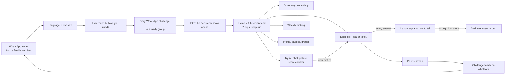
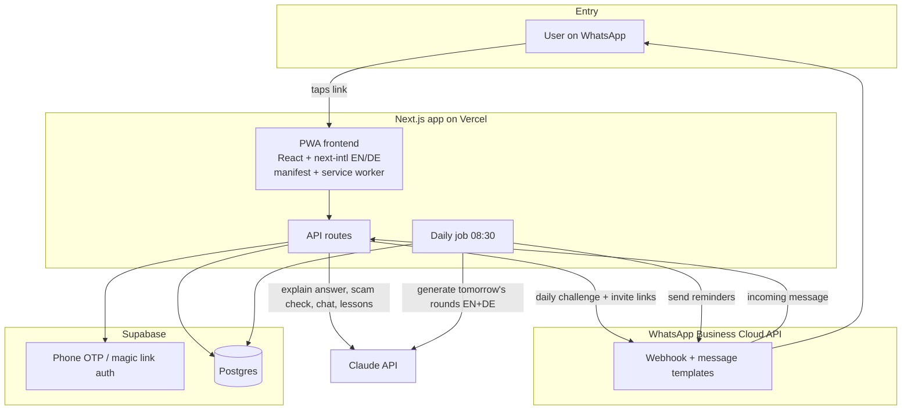

# Fenster: proposal, user journey and architecture

> Status: draft for team review. The clickable prototype is in [`prototype/`](../prototype/) (fake data, no backend yet).

## 1. In one sentence each (for the README)

1. **Audience:** Older adults (60+) in Germany who use WhatsApp every day but have barely used AI themselves.
2. **Problem:** They can't tell AI-made or scam content (fake emails, "grandchild" texts, AI pictures) from real content, because they have never created anything with AI themselves.
3. **Our demo:** A WhatsApp invite opens a bilingual (German/English) web app where they swipe through a 5-minute daily "Real or fake?" feed of 7 clips (videos, news articles, emails, texts, photos, voice notes), Claude explains each answer, and they try AI safely themselves and share challenges with their family.

## 2. What we read from the board

### Image 1: events and tasks (each one earns points)

| Sticky note | Becomes in the app |
|---|---|
| Identify the fraud email / fraud call / fake news / propaganda (with AI) | Clips in the daily **"Real or fake?"** feed (video, newspaper, email, SMS, photo, voice note, website) |
| Identify AI image ✓, "Game: guess is it AI or not, **and why**" | Picture round + Claude's **"How to tell"** explanation after every answer |
| Fake game: show two objects, real vs fake (texts, emails, images). **Low score → intervention** | A/B game format. Wrong answer or low score → gentle 2-minute lesson, never a penalty |
| Create a good-morning message for your children and send it on WhatsApp (with AI) | Task + **AI helper chat** with a "Send on WhatsApp" button |
| Teach how to create AI content. "Learning by doing: the more they create, the more they can identify" | **Try AI** tab: chat, make a picture, then turn your picture into a challenge for friends |
| AI detector: check and share scams | **Scam checker**: paste a message, Claude explains the warning signs, "Warn my group" |
| Possibility to learn how to report such things ★ | "How to report a scam" lesson, linked from the scam checker |
| Safety rules: AI can make mistakes, not everything is true | First lesson + disclaimer under every AI answer |
| Teach how you can do things with AI (search, agents…) / Ask AI before doing something | Tasks "Ask AI before you buy something" + lessons |
| Explain to your friends what AI is | Task worth extra points (+ "Teacher" badge) |
| Challenge friends to guess if it's real or AI ★★ | "Challenge your family" share after every game |
| ★ Evening social game | Evening live quiz with your group (lobby screen in prototype; build later) |

### Image 2: building blocks

- **Community:** anybody can create, anybody can join → groups, invites, user-made challenges.
- **Gaming:** scores and weekly leaderboard, progression (levels), streaks, rewards (badges).
- **Teaching:** periodic quizzes, on-demand games, level/experience-based teaching, sharing with family.
- **Tech:** native-feeling PWA (web + phone), notifications on WhatsApp, auth by phone, database schema.
- **Content:** quiz content (generated by us, with Claude).

### Image 3: user journey (screens)

WhatsApp message → web link → onboarding + permissions (invited to a group) → **Home** (task list, content from others, sharing) → **Leaderboard** (weekly: score / streak) → **On-demand edu content** (grid) → **Playground / Create** (chat, create image, create and share content, copy-paste to check fraud) → **Profile**.

## 3. User journey (as built in the prototype)

Open `prototype/journey.html` to see every screen side by side, in English or German.



### Home = the daily game, as a feed like TikTok

After onboarding, a short intro plays. A white screen shows the white window outline and the small title "Fenster", then the window opens and the white fades away into Home. Home is a full-screen vertical feed: one clip at a time, swipe up (or tap the big **Next** button, for people who don't know swiping). Each clip shows a different kind of media, and the user taps **Real** or **Fake / AI**:

| # | Medium | Example | Answer |
|---|---|---|---|
| 1 | Video | "Night camera" bunnies on a trampoline (a bunny vanishes mid-jump) | AI |
| 2 | Newspaper article | Lookalike "The New York Chronicle": coffee adds 10 years to your life | Fake |
| 3 | Email | "Your account will be blocked TODAY", asks for your PIN | Scam |
| 4 | SMS | Choir friend moves practice to Thursday | Real |
| 5 | Photo | Bakery photo, the hand has six fingers | AI |
| 6 | Voice note | Cloned "grandchild" voice: car accident, needs €2,000 | AI scam |
| 7 | Website | City library opens longer on Saturdays | Real |

Real items are mixed in on purpose, so people learn to check instead of distrusting everything. The newspaper uses a made-up name (no real brands). In the real app Claude makes a new set of 7 every day in both languages; the videos and photos come from a checked library of real and AI clips.

The loop that matters for the demo: **invite → play → understand why → share → the next person is invited.**

## 4. Design choices for older adults

- **Atkinson Hyperlegible** font (made for low vision), 20px base text, "Make the text bigger" as the 2nd onboarding question.
- One main action per screen, full-width buttons at least 60px tall, every icon has a text label.
- High contrast, calm colours. Success is green, mistakes are warm and gentle ("That's okay, this one is tricky").
- No passwords: the WhatsApp link logs you in. No app store: it's a PWA.
- German uses the polite **"Sie"** form.
- Every AI answer carries "AI can be wrong too. When in doubt, ask someone you trust."
- All design tokens are in `prototype/styles.css` `:root`. The real design system will replace them.

## 5. Architecture

> **Superseded:** the current stack (plain JS PWA + small Node server, no auth/DB, content in git) is in
> [ARCHITECTURE.md](ARCHITECTURE.md). The diagram below is the longer-term picture.



| Layer | Choice | Why |
|---|---|---|
| Frontend | Next.js (App Router) as a PWA, `next-intl` for EN/DE | One codebase for desktop + phone, installable, no app store |
| i18n | All UI strings in `messages/en.json` and `messages/de.json`; Claude content generated in the user's language | Two languages from day one |
| Backend | Next.js API routes (serverless) | No extra server to run |
| Database + auth | Supabase (Postgres, phone OTP) | Phone number is the identity older adults already have |
| AI | Claude API: a fast model for live answers (scam check, chat, "why"), a stronger one for generating daily rounds and lessons | Claude is part of the product, not just the tool |
| WhatsApp | WhatsApp Business Cloud API (later). For the demo: a share link (`wa.me/?text=…`) | Real API needs a verified Meta business account |
| Prompts | `prompts/*.md`, one file per job | Easy for non-developers to tweak |

### Where Claude is used in the product

1. **Explain the answer** ("How to tell"): after each round, 3 short clues in simple language.
2. **Scam checker:** user pastes a message → verdict, warning signs, what to do, how to report (structured JSON output).
3. **AI helper chat:** safe first experience (good-morning message, "ask before you buy").
4. **Content engine:** generates new daily rounds (realistic fake + real email/SMS pairs) and lessons, in German and English, at 3 levels. Reviewed by us before publishing.
5. **Intervention:** after a low score, picks the lesson that matches the mistakes.

Note: Claude does not generate images. For picture rounds we use a curated set of real vs AI photo pairs (credited), and for "Make a picture" an image API later.

### Data model (first version)

```
users(id, phone, name, lang, text_size, level, created_at)
groups(id, name, owner_id, invite_code)
group_members(group_id, user_id, joined_at)
challenges(id, date, type[email|sms|image], lang, option_a, option_b, answer, clues[], level)
attempts(id, user_id, challenge_id, picked, correct, points, created_at)
lessons(id, slug, lang, level, cards[], quiz)
user_stats(user_id, points_week, points_total, streak, last_played)   -- or a view
shares(id, user_id, group_id, kind, payload, created_at)
```

## 6. Plan for the rest of today (deadline 16:00, freeze 15:00)

The prototype already demos the full journey. To make Claude really part of it:

1. **Must (by 14:45):** add a tiny backend with 2 real Claude calls: the **scam checker** and the **"How to tell"** explanation. Keep everything else fake data.
2. **Nice:** "Share on WhatsApp" opens a real `wa.me` link with the challenge text.
3. **Cut for today:** real WhatsApp API, auth, database, evening game, image generation, leaderboard backend.
4. **15:00:** record the 2-minute video following the journey map: invite → onboarding → window intro → swipe the feed → wrong answer + lesson → scam checker live with Claude → share.

## 7. Open questions for the team

- Product name: "Fenster" (German for "window": a window into AI). Confirmed.
- Is the audience "older adults in Germany" or wider?
- Do we keep the persona "Anna, invited by her grandson Max" for the demo video?
